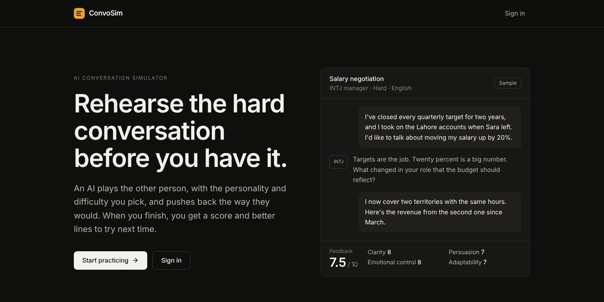
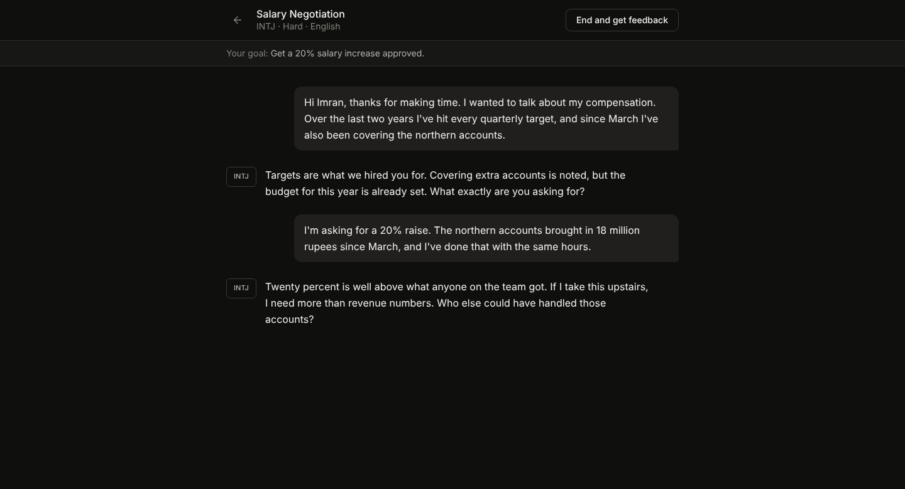
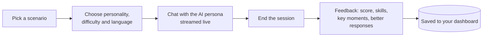

<div align="center">

# ConvoSim

**Rehearse the hard conversation before you have it.**
An AI plays the other person, pushes back the way they would, and then tells you how you did.

[**Try it live**](https://ai-convo-simulator.vercel.app) · [How a session works](#how-a-session-works) · [Run it locally](#run-it-locally)




</div>

## What it is

A flight simulator for real-life conversations: salary negotiations, job interviews, sales calls, angry customers and difficult coworkers.

- **Pick a situation** from the starter scenarios and add your own context and goal.
- **Choose who you face**: any of the 16 MBTI personalities, at easy, medium or hard difficulty.
- **Talk it through** with an AI that stays in character and streams its replies as it types.
- **Get feedback**: an overall score, four skill scores, what worked, what to work on, key moments, and better lines to try next time.
- Works in **English and Roman Urdu**, for both the conversation and the feedback.



## How a session works



The persona prompt is built from the scenario, your goal and the chosen personality's traits, resistance patterns and speech style. When you end the session, a second call reads the full transcript and returns structured feedback scored on **clarity, persuasion, emotional control and adaptability**.

## Tech stack

| Layer | Technology |
| --- | --- |
| Frontend | Next.js (App Router), TypeScript, Tailwind CSS |
| Backend | FastAPI (Python), Server-Sent Events for streaming |
| AI | Groq, `openai/gpt-oss-120b` by default (set with `GROQ_CHAT_MODEL`) |
| Database and auth | Supabase: PostgreSQL with Row Level Security, email and password sign-in |
| Hosting | Vercel (frontend), Render (backend) |

## Project structure

```
frontend/src/
  app/          pages: landing, login, dashboard, scenarios, session, feedback
  components/   shared UI
  lib/          API client, Supabase client, shared types
backend/
  routers/      chat, sessions, scenarios, feedback endpoints
  services/     Groq client, personality prompts, feedback analyzer
supabase/
  migrations/   database schema and starter scenarios
```

## Run it locally

You need Node.js 18+, Python 3.11+, a Supabase project and a free Groq API key.

**1. Database.** Run the files in `supabase/migrations/` in order in the Supabase SQL editor. This creates the tables, the security policies and the starter scenarios.

**2. Backend**

```bash
cd backend
python -m venv .venv
source .venv/bin/activate        # Windows: .venv\Scripts\activate
pip install -r requirements.txt
cp .env.example .env             # add GROQ_API_KEY, SUPABASE_URL, SUPABASE_SERVICE_ROLE_KEY
uvicorn main:app --reload
```

**3. Frontend**

```bash
cd frontend
npm install
npm run dev
```

Before `npm run dev`, create `frontend/.env.local` with:

```
NEXT_PUBLIC_SUPABASE_URL=
NEXT_PUBLIC_SUPABASE_ANON_KEY=
NEXT_PUBLIC_API_URL=http://localhost:8000
```

Then open http://localhost:3000.

## Deploy

- **Frontend:** Vercel, with the root directory set to `frontend/` and the three variables above.
- **Backend:** Render, using the included `render.yaml`. Set `ALLOWED_ORIGINS` to your Vercel URL.

---

<div align="center">

Built by [Ziyad Hisham](https://ziyadhisham.com)

</div>
